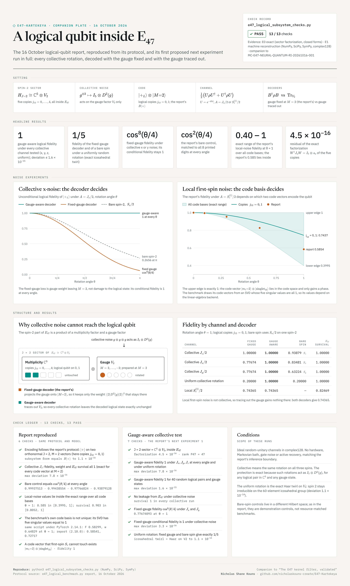

# E47 logical qubit in the spin-2 multiplicity: reproduction and gauge-aware test

**Machine record:** [`MC-E47-LOGICAL-SUBSYSTEM-20261016-001`](../../certificates/MC-E47-LOGICAL-SUBSYSTEM-20261016-001.json) · **PASS 13/13**

**Evidence:** E0 exact mathematics ($H_{J=2}\cong\mathbb C^5\otimes V_2$; closed forms $\cos^2(\theta/4)$, $\cos^8(\theta/4)$, $1/5$) · E1 deterministic machine reconstruction (NumPy, SciPy, SymPy, complex128)

**Checks:** [`quantum_information/e47_logical_benchmark.py`](quantum_information/e47_logical_benchmark.py) · companion to [E47 neural–quantum benchmark and Recursive Identity validation](E47_Neural_Quantum_RI_Validation.md)

**Author:** Nicholas Shane Kouns · 16 October 2026



## Setting

- The $J = 2$ sector of $E_{47}$ factors as $H_{J=2}\cong\mathbb C^5\otimes V_2$: five copies (intermediate coupling $j_{12} = 0,\dots,4$) times spin 2. Collective rotations $g^{\otimes3}$ act on it as $I_5\otimes D^2(g)$.
- Code: $\lvert{+}_L\rangle$ on copies $j_{12} = 0, 1$ with gauge $\lvert M{=}2\rangle$, i.e. $\lvert{+}\rangle$ on two orthonormal $J = 2$, $M = 2$ vectors, as in the benchmark protocol.
- Channel: $N_{\theta,A}(\rho) = \tfrac12(U\rho U^\dagger + U^\dagger\rho U)$, $U = e^{-i\theta A}$, with $A = J_a/2$ (collective) or $S_z^{(1)}/2$ (first spin).
- Decoders: fixed gauge $B^\dagger\rho B$ (the benchmark's) and gauge-aware $\mathrm{Tr}_{V_2}$ on the multiplicity factor.

## Results at θ = 1

| Channel | Fixed gauge | Gauge aware | Bare spin-2 | $E_{47}$ survival |
|---|---|---|---|---|
| Collective $J_z/2$ | 1.00000 | 1.00000 | 0.93879 ($S_z$) | 1.00000 |
| Collective $J_x/2$ | 0.77674 | 1.00000 | 0.83481 ($S_x$) | 1.00000 |
| Collective $J_y/2$ | 0.77674 | 1.00000 | 0.63224 ($S_y$) | 1.00000 |
| Uniform collective rotation | 0.20000 | 1.00000 | 0.20000 | 1.00000 |
| Local $S_z^{(1)}/2$ | 0.74365 | 0.74365 | — | 0.82469 |

## Gauge-aware collective test

This is the first next experiment proposed in the logical-qubit report: collective $J_x$, $J_y$ noise with a gauge-aware decoder.

- The gauge-aware decoder returns logical fidelity 1 under $J_x$, $J_y$, $J_z$ at every angle and under a uniformly random collective rotation (maximum deviation $7.8\times10^{-16}$), and for 40 random logical pairs in $\mathbb C^5$ with random gauge states ($1.6\times10^{-15}$).
- The uniform rotation is an exact twirl over the 60-element icosahedral group; spin 2 stays irreducible on that group, so the twirl equals the Haar twirl on $V_2$ (to $1.1\times10^{-14}$).
- The fixed-gauge decoder gives $\cos^8(\theta/4)$ under $J_x$ and $J_y$, and exactly $1/5$ under the uniform rotation; its conditional fidelity is 1 throughout. The loss is gauge weight leaving $M = 2$.
- Collective noise causes no leakage from $E_{47}$.

## Reproduction of the logical-qubit report

- Collective $J_z$: fidelity, code weight and $E_{47}$ survival are exactly 1 for every code vector at $M = 2$.
- Bare control: $\cos^2(\theta/4)$, matching all eight printed digits at every angle.
- Local first-spin $S_z$: the fidelity of the encoded $\lvert{+}\rangle$ is $\lvert\langle v\rvert U\lvert v\rangle\rvert^2$ for the code vector $v$, so it depends on the chosen pair. Over every valid choice at $\theta = 1$, fidelity spans $[0.3995, 1]$ and survival $[0.8052, 1]$; the report's 0.5854 and 0.9032 lie inside. The upper edge is attained by $\lvert m_1{=}2\rangle\otimes\lvert\text{singlet}_{23}\rangle$, which lies in the code space and only gains a phase.
- The benchmark takes its two code vectors as the first two left singular vectors of $P_{J=2}$ restricted to the $M = 2$ product states. All five nonzero singular values equal 1, so the pair is not unique and depends on the linear-algebra backend. The unchanged script (SHA-256 `c5581dae…`) run under PyTorch 2.14.1 gives fidelity 0.58298921, code weight 0.64828921 and survival 0.87306499 at $\theta = 1$; the report, run under PyTorch 2.10.0, lists 0.58541196, 0.72717416 and 0.90323760. Specifying the pair explicitly, for example copies $j_{12} = 0, 1$ (fidelity 0.74365467), makes the local values backend-independent.

## Conditions

Ideal random-unitary channels in complex128; no hardware, Markovian bath, gate noise or active recovery, matching the benchmark's evidence boundary. Bare-spin controls live in a different Hilbert space and are demonstration controls, as in the report.

## Reproduce

```bash
pip install numpy scipy sympy
python3 research/e47/validation/e47_logical_subsystem_checks.py --json certificates/MC-E47-LOGICAL-SUBSYSTEM-20261016-001.json
```
