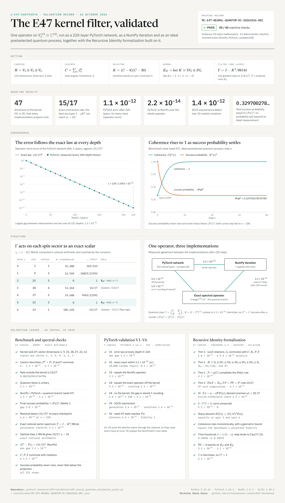

# E47 neural–quantum benchmark and Recursive Identity: validation

**Machine record:** [`MC-E47-NEURAL-QUANTUM-RI-20261016-001`](../../certificates/MC-E47-NEURAL-QUANTUM-RI-20261016-001.json) · **PASS 45/45**

**Evidence:** E0 exact mathematics (rational sector spectra, optimal step, rate 15/17) · E1 deterministic machine reconstruction (NumPy and PyTorch, complex128)

**Author:** Nicholas Shane Kouns · validation run 16 October 2026



## Setting

$H = V_2\otimes V_2\otimes V_2 \cong \mathbb C^{125}$, with total angular momentum $J_a = \sum_r I^{\otimes(r-1)}\otimes S_a\otimes I^{\otimes(3-r)}$ and Casimir $C = \sum_a J_a^2$.

$$K = (C-6)(C-30),\qquad E_{47} = \ker K \cong 5V_2\oplus 2V_5,\qquad \Gamma = I - \frac{K^2}{99144},$$

with $P$ the orthogonal projector onto $E_{47}$. One application of $\Gamma$ is one gradient-descent step on $\tfrac12\Vert K\psi\Vert ^2$ with step size $1/99144 = 2/(11664+186624)$.

## Exact statements (E0)

On the spin-$j$ sector, $\Gamma$ acts as the scalar $\gamma_j = 1 - K_j^2/99144$:

| $j$ | dim | copies | $K_j^2$ | $\gamma_j$ |
|---|---|---|---|---|
| 0 | 1 | 1 | 32,400 | 103/153 |
| 1 | 9 | 3 | 12,544 | 10825/12393 |
| 2 | 25 | 5 | 0 | 1 (kernel) |
| 3 | 28 | 4 | 11,664 | 15/17 |
| 4 | 27 | 3 | 19,600 | 9943/12393 |
| 5 | 22 | 2 | 0 | 1 (kernel) |
| 6 | 13 | 1 | 186,624 | −15/17 |

Hence, for every $L \ge 0$: $\Vert \Gamma^L - P\Vert _2 = (15/17)^L$; $15/17 = (\kappa-1)/(\kappa+1)$ with $\kappa = 16$ is the smallest spectral radius off $E_{47}$ of any layer $I - \eta K^2$, attained only at $\eta = 1/99144$; and $\Gamma$ commutes with the $SO(3)$ action.

## 1 · The benchmark

[`e47_neural_quantum_benchmark.py`](validation/e47_neural_quantum_benchmark.py) applies $\Gamma$ 220 times to a seed-47 random state as a NumPy iteration, a PyTorch network and an ideal postselected quantum statevector simulation with block unitary $\mathbb U = \begin{pmatrix}\Gamma & B\\ B & -\Gamma\end{pmatrix}$, $B = (I-\Gamma^2)^{1/2}$. The file is committed byte-identical to the version validated. Its own checks (12) pass:

- kernel rank 47; sector dimensions 1, 9, 25, 28, 27, 22, 13
- Casimir Hermiticity error 0; $P^2 = P$ to $1.2\times10^{-14}$; $[P,\Gamma] = 0$ to $5.7\times10^{-15}$
- spectral radius off the kernel $0.8823529411764706 = 15/17$
- block unitarity $1.1\times10^{-16}$; NumPy–PyTorch $1.5\times10^{-14}$; NumPy–quantum $2.1\times10^{-13}$
- final success probability $0.32970027872976$ against $\Vert P\psi\Vert ^2 = 0.329700278729789$; final fidelity 1
- residual below $(15/17)^n$ at every checkpoint; $6.4\times10^{-13}$ at $n = 220$

## 2 · Spectral checks (9)

[`e47_neural_quantum_spectral_checks.py`](validation/e47_neural_quantum_spectral_checks.py): $C$, $P$, $\Gamma$ commute with every $J_a$ (≤ $1.2\times10^{-13}$, Frobenius); the spectral $\Gamma$ equals $I - K^2/99144$ to $3.5\times10^{-14}$; the sector values above hold in rational arithmetic and match the numerics; the optimal step and rate hold exactly; $\Vert \Gamma^n - P\Vert _2 = (15/17)^n$ at $n = 1, 10, 50, 100, 220$ to $1.1\times10^{-14}$; the success probability never rises and never falls below $\Vert P\psi\Vert ^2$ over all 221 steps.

## 3 · PyTorch validation V1–V6 (7)

[`e47_neural_quantum_pytorch_validation.py`](validation/e47_neural_quantum_pytorch_validation.py), PyTorch 2.14.1 on CPU, complex128. V1–V5 push the identity matrix through the network, so they cover every input.

| | Measured |
|---|---|
| V1 error law, every depth $L = 0,\dots,220$ | $\lvert\Vert N_L - P\Vert _2 - (15/17)^L\rvert \le 1.2\times10^{-14}$; $\Vert N_{220}-P\Vert _2 = 1.1001\times10^{-12}$ |
| V2 every input | $\Vert N_{220}\psi - P\psi\Vert  \le 1.1001\times10^{-12}\Vert \psi\Vert $; 10,000 random inputs: $8.1\times10^{-13}$ |
| V3 NumPy operator | $2.2\times10^{-14}$ |
| V4 exact spectral operator (the quantum branch's operator) | off the kernel $5.3\times10^{-16}$; coupling $1.1\times10^{-14}$; on the kernel $1.0\times10^{-12}$, the stored $\Gamma$'s unit eigenvalues sitting within $4.1\times10^{-15}$ of 1, accumulated over 220 layers |
| V5 $SO(3)$ equivariance | generators $2.6\times10^{-12}$; 20 random rotations $1.44\times10^{-12}$ |
| V6 seed-47 state | PyTorch–NumPy $1.5\times10^{-14}$; distance to $P\psi$ $6.4\times10^{-13}$; fidelity 1 |

**Established.** The 220-layer PyTorch network whose single shared layer is the optimal-step gradient descent on $\tfrac12\Vert K\psi\Vert ^2$ computes, for every input in $(\mathbb C^5)^{\otimes3}$, the orthogonal projection onto $E_{47} = 5V_2\oplus2V_5$ to within $1.1\times10^{-12}$ of the input's norm. Its error follows $\Vert N_L - P\Vert _2 = (15/17)^L$ at every depth from 0 to 220 to within $1.2\times10^{-14}$; it is $SO(3)$-equivariant to within $1.5\times10^{-12}$; and it agrees with the NumPy implementation to within $2.2\times10^{-14}$.

## 4 · Recursive Identity formalization (16 + 1)

[`e47_recursive_identity_checks.py`](validation/e47_recursive_identity_checks.py) checks the formalization's stated claims:

- **Theorem 1.** su(2) relations to $1.8\times10^{-15}$; $J_a$ commutes with $C, K, P, \Gamma$ (relative ≤ $5.4\times10^{-14}$); $H \cong V_0\oplus3V_1\oplus5V_2\oplus4V_3\oplus3V_4\oplus2V_5\oplus V_6$; $\dim\ker K = 47$. The (Poly) rule extends to $P$ because $P = p(C)$ for the Lagrange polynomial with $p(6) = p(30) = 1$ and $p = 0$ at the other five Casimir values ($4.3\times10^{-14}$).
- **Theorem 2.** $\Gamma$ has exactly 47 unit eigenvalues, $\operatorname{Fix}\Gamma = E_{47}$; $\Gamma P = P\Gamma = P$ to $4.7\times10^{-15}$; $\Vert \Gamma(I-P)\Vert _2 = 15/17$.
- **Section IV.** $\Gamma\psi = \psi - \eta\nabla E(\psi)$ with $\nabla E = K^2\psi$ (finite-difference check $1.9\times10^{-10}$); $\eta\lambda_{\max} = 32/17 \le 2$.
- **Section V.** $\mathbb U^\dagger\mathbb U = I$ to $5.1\times10^{-14}$; $\Vert \Gamma\psi\Vert ^2 + \Vert B\psi\Vert ^2 = \Vert \psi\Vert ^2$ exactly in the run.

and five consequences of the same definitions:

1. $E(\Gamma\psi) \le (15/17)^2E(\psi)$ for every $\psi$, with equality on the $j = 3$ and $j = 6$ sectors.
2. $\mathcal C(\Gamma^n\psi) = \Vert P\psi\Vert ^2/(\Vert P\psi\Vert ^2 + \Vert \Gamma^n(I-P)\psi\Vert ^2)$ is non-decreasing with $1 - \mathcal C(\Gamma^n\psi) \le (15/17)^{2n}(1-\mathcal C(\psi))/\mathcal C(\psi)$; it equals the benchmark's projected fidelity (the +1 cross-check).
3. For any loop rate $\ell > 0$, $T$ increases along the recursion toward $\int_{\mathcal C(\psi_0)}^1 \ell(c)\,dc$; with $\ell(c) = 1/(1-c)$ each step adds $2\ln(17/15) \approx 0.2503$ asymptotically (measured 0.25036 between $n = 200$ and $300$).
4. $\nabla\mathcal C(\psi) = 2(P\psi - \mathcal C(\psi)\psi)/\Vert \psi\Vert ^2$ vanishes exactly on $E_{47}$ and $E_{47}^\perp$.
5. $\mathbb U$ is Hermitian, so $\mathbb U^2 = I$.

As the formalization's evidence boundary states, Section VI introduces definitions (loop rate, state-to-field map, typing maps) rather than consequences of the SU(2) algebra; the checks cover the mathematics that follows from the stated definitions.

## Harness note

The first suite run used a tolerance of $10^{-14}$ for the NumPy operator-norm check and failed at $n = 10$, where double-precision roundoff gives $1.13\times10^{-14}$ (relative $3.9\times10^{-14}$). The tolerance is now $10^{-13}$, matching V1. No other check changed.

## Reproduce

```bash
pip install numpy scipy torch
python3 research/e47/validation/e47_neural_quantum_validation_suite.py   # writes the machine record
python3 research/e47/validation/e47_neural_quantum_pytorch_validation.py # V1–V6 report
python3 research/e47/validation/e47_recursive_identity_checks.py
python3 research/e47/validation/e47_neural_quantum_spectral_checks.py
```

Recorded environment: Python 3.13.16 · PyTorch 2.14.1 (CPU) · NumPy 2.5.3 · SciPy 1.18.1. The machine record stores the SHA-256 of every source file.
